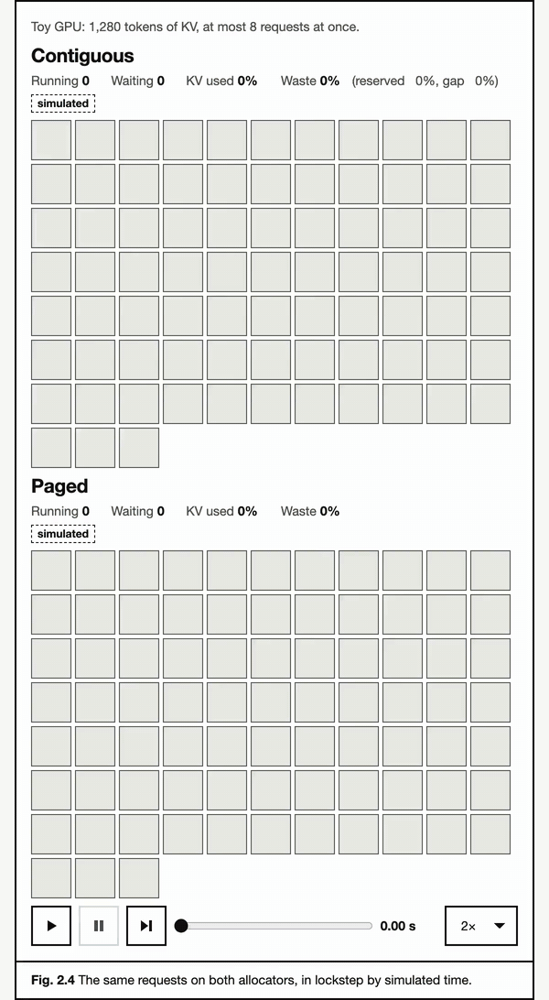

# serving-explained

[](https://github.com/varad-more/serving-explained/actions/workflows/ci.yml)
[](#license)

Interactive explainers of how LLM servers manage GPU memory and schedule
requests, run on a small simulated engine in your browser.



**Try it: https://varadmore.me/serving-explained/**

## Chapters

Each chapter adds one mechanism to the same engine. After it, you can explain:

1. [The KV cache](https://varadmore.me/serving-explained/kv-cache/): why it,
   not compute, usually caps how many requests fit on a GPU.
2. [Paged attention](https://varadmore.me/serving-explained/paged-attention/):
   how fixed-size blocks cut the waste to at most one partly filled block per request.
3. [Continuous batching](https://varadmore.me/serving-explained/continuous-batching/):
   why scheduling trades time to first token (TTFT), inter-token latency
   (ITL), and throughput.
4. [Prefix caching](https://varadmore.me/serving-explained/prefix-caching/):
   when shared prefixes hit the cache, and why eviction lowers the hit rate.

The [sandbox](https://varadmore.me/serving-explained/sandbox/) combines all
four on a workload and compares two configurations side by side.

## Why you can trust it

- Every technical claim cites a source in [docs/SOURCES.md](docs/SOURCES.md):
  a paper, official docs, or a source file at a pinned commit.
- Every number carries a badge: `simulated` (the toy engine), `computed`
  (llmsize's formulas), or `measured` (linked to a committed benchmark file).
- Each claim the text makes about the simulation is tagged, and a test in
  [tests/chapters/](tests/chapters/) checks it against its preset.
- [docs/SIM.md](docs/SIM.md) lists every simplification. Each chapter ends
  with "What this leaves out".
- Simulated numbers show mechanisms, not real-world speed.

## How it works

A deterministic TypeScript engine, modeled on vLLM V1's scheduler and block
manager, runs in your browser. Each step's time comes from a roofline model
that uses llmsize's GPU and model numbers. Every animated widget replays the engine's
event log, so the picture is exactly what the engine did.

Run it locally (Node 24 and pnpm):

```sh
pnpm install
pnpm dev                      # the site, at http://localhost:5173/serving-explained/
pnpm test                     # unit, property, and chapter-claim tests
pnpm sim --preset chatbot     # one preset from the command line
```

## Found a mistake?

Please [report a technical error](https://github.com/varad-more/serving-explained/issues/new?template=technical-error.yml)
with the claim, where it appears, and a source. Fixes are credited in
[CHANGELOG.md](CHANGELOG.md). [CONTRIBUTING.md](CONTRIBUTING.md) covers bugs
and chapter ideas.

## Credits

Papers:
- Kwon et al., [Efficient Memory Management for Large Language Model Serving with PagedAttention](https://doi.org/10.1145/3600006.3613165), SOSP 2023
- Yu et al., [Orca: A Distributed Serving System for Transformer-Based Generative Models](https://www.usenix.org/conference/osdi22/presentation/yu), OSDI 2022
- Agrawal et al., [SARATHI: Efficient LLM Inference by Piggybacking Decodes with Chunked Prefills](https://arxiv.org/abs/2308.16369), 2023
- Agrawal et al., [Taming Throughput-Latency Tradeoff in LLM Inference with Sarathi-Serve](https://www.usenix.org/conference/osdi24/presentation/agrawal), OSDI 2024
- Zheng et al., [SGLang: Efficient Execution of Structured Language Model Programs](https://proceedings.neurips.cc/paper_files/paper/2024/hash/724be4472168f31ba1c9ac630f15dec8-Abstract-Conference.html), NeurIPS 2024
- Ainslie et al., [GQA: Training Generalized Multi-Query Transformer Models from Multi-Head Checkpoints](https://aclanthology.org/2023.emnlp-main.298/), EMNLP 2023

Software and data:
- vLLM's [prefix caching design doc](https://github.com/vllm-project/vllm/blob/cfd54ca8819de923dcf555807298eaca34dd342d/docs/design/prefix_caching.md)
  and [source](https://github.com/vllm-project/vllm/tree/cfd54ca8819de923dcf555807298eaca34dd342d),
  pinned to the commit the chapters cite
- [llmsize](https://varadmore.me/llm-calculator/) ([varad-more/llm-calculator](https://github.com/varad-more/llm-calculator)):
  the sizing math behind every `computed` number
- [inference-engine-benchmark-system](https://github.com/varad-more/inference-engine-benchmark-system):
  the source of every `measured` number, in chapter 3
- [kv-transfer-tax](https://github.com/varad-more/kv-transfer-tax): its
  replica balancer's code, cited in chapter 4

## License

- **Code** is under the [Apache License 2.0](LICENSE): everything in this
  repo except the paths below, including `docs/`.
- **Text and media** are under [CC BY 4.0](LICENSE-CONTENT): the chapter and
  glossary text (`src/chapters/**/*.mdx`, `src/chapters/glossary.ts`), and
  the captures and preview images (`media/`, `public/og/`,
  `docs/launch/*.png`).
